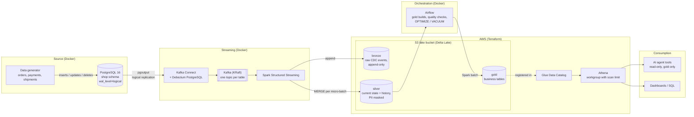

# cdc-lakehouse-aws

🌎 [Español](README.md) | English

Real-time change data capture (CDC) from PostgreSQL into a Delta Lake lakehouse on Amazon S3,
with a gold layer that dashboards and AI agents can query safely.

## Why this project

Many companies want to "add AI" on top of data that lives in the operational database, gets exported by
nightly scripts, and nobody fully trusts. This project shows an end-to-end alternative that a startup can
run without a data team:

- Every insert, update and delete in the source is captured within seconds, and history is kept.
- Personal data never reaches the queryable layers unmasked.
- Nothing is published without passing quality checks.
- An AI agent answers business questions through read-only tools, never through free-form SQL.

The example is **ShopFlow**, a fictional LATAM e-commerce ([data model](docs/en/data-model.md)).

## Architecture



**Bronze** stores every event exactly as it arrives (a replayable log), **silver** keeps current state and
history with an idempotent `MERGE`, and **gold** holds small business tables that Airflow rebuilds and
audits before publishing. Athena queries gold, and the agent reaches it only through a fixed set of tools.

## Verified results

- **Exactly-once from Kafka to bronze:** 0 duplicates and 0 offset gaps across all 6 topics.
- **Silver matches the source:** after ~200,000 change events, 15 business metrics (counts and amounts by
  status for orders, payments, shipments, customers and prices) match PostgreSQL exactly.
- **Replays are no-ops:** with the checkpoint deleted and the full history reprocessed, the `MERGE`s
  reported 0 rows inserted, updated or deleted.
- **The audit says no:** 25 quality checks (write-audit-publish) blocked two publishes on the first run,
  both caused by real data issues.
- **Least privilege, tested:** the pipeline can only write to the lake prefixes and only from the VM's IP;
  the agent can only run Athena queries, so its key cannot download a single file.

## Stack

| Layer | Technology |
|---|---|
| Source and CDC | PostgreSQL 16, Debezium 3.6 (`pgoutput`), Kafka 4.3 (KRaft) |
| Processing | Spark 4.2 Structured Streaming, Delta Lake 4.4 |
| Storage and query | Amazon S3, AWS Glue Data Catalog, Amazon Athena |
| Orchestration | Airflow 3.3 (`gold_pipeline` every 15 min, daily maintenance) |
| AI agent | MCP server with 8 read-only tools ([design](docs/en/agent-tools.md)) |
| Infrastructure | Terraform, Docker Compose with memory limits |

**Cost:** a few dollars a month on AWS (S3 storage and Athena queries capped at 1 GB), with an AWS Budget
alarm. Compute runs on an existing VM.

## Quickstart

Requirements: Docker with Compose v2 and about 3 GB of free RAM.

```bash
cp docker/.env.example docker/.env               # fill in the passwords
docker compose -f docker/compose.yaml up -d      # PostgreSQL, Kafka and Debezium
./scripts/register-connector.sh                  # register the CDC connector
docker compose -f docker/compose.yaml --profile generator up -d generator   # live data
```

The full setup (Spark, Terraform, Airflow and the agent) is in the
[technical details](docs/en/technical-details.md#quickstart).

## Documentation

- [Technical details](docs/en/technical-details.md): data flow, design decisions (and when I would pick the
  managed AWS alternative), security and every layer in depth.
- [Data model](docs/en/data-model.md): domain, source tables and CDC decisions.
- [Agent tools](docs/en/agent-tools.md): design, guardrails and data limitations.

## Next steps

- [ ] Generator: carriers consistent with the customer's country
- [ ] Gold: shipments_daily (on-time denominator for late rates) and build metadata for freshness
- [ ] Demo video

## Repository layout

```
docker/      Docker Compose stack and service configs
generator/   Live data generator for the source database
scripts/     Helper scripts
terraform/   AWS infrastructure
spark/       Streaming and batch jobs
airflow/     DAGs
agent/       MCP server with read-only AI agent tools
docs/        Technical details, data model and agent design (Spanish); English in docs/en/
```

## License

[MIT](LICENSE)
