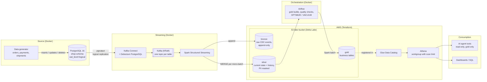

# cdc-lakehouse-aws

Real-time change data capture from PostgreSQL into a Delta Lake lakehouse on Amazon S3,
with a gold layer that dashboards and AI agents can query safely.

> **Status:** work in progress. See [Roadmap](#roadmap).

## Why this project

Most small companies want to "add AI" on top of data that lives in an operational
database, gets exported by nightly scripts, and nobody fully trusts. This project
shows an end-to-end alternative that a startup can run without a data team:

- Every insert, update and delete in the source database is captured within seconds.
- History is kept (order status transitions, price changes), not overwritten.
- PII never leaves the silver layer unmasked.
- The gold layer is cheap to query on AWS and exposed to an AI agent through
  narrow, read-only tools instead of raw database access.

The example domain is **ShopFlow**, a fictional LATAM e-commerce. See
[docs/data-model.md](docs/data-model.md).

## Architecture



### Data flow

1. **Capture.** Debezium reads the PostgreSQL write-ahead log through a logical
   replication slot and publishes one event per row change to Kafka
   (`shopflow.shop.<table>`). Each event carries the row before and after the change.
2. **Bronze.** A Spark streaming job appends every event as-is to Delta tables on S3,
   partitioned by table and date. Bronze is the replayable audit log.
3. **Silver.** A second streaming query `MERGE`s each micro-batch into clean tables:
   current state for most entities, SCD Type 2 history for `products`, an
   `order_status_history` table built from status transitions, and masked PII.
   Late or duplicated events are resolved using the source LSN, so reprocessing is
   idempotent.
4. **Gold.** Airflow rebuilds business tables from silver on a schedule (sales by
   country and category, payment failure rates, late shipments, order lead times,
   customer lifetime value) and runs data quality checks before publishing them.
5. **Serve.** Gold tables are registered in the Glue Data Catalog and queried with
   Athena. The AI agent gets a small set of read-only tools on top of those tables.

### Where each piece runs

| Component | Runs on | Why |
|---|---|---|
| PostgreSQL, Kafka, Debezium, Spark, Airflow | Docker Compose on a single VM, with per-service memory limits and profiles | Keeps the always-on cost at zero; the same images run on ECS/EKS |
| Delta tables (bronze, silver, gold) | Amazon S3 | Durable, cheap storage that any engine can read |
| Catalog and SQL | AWS Glue Data Catalog + Amazon Athena | Serverless, pay per query, no cluster to keep running |
| AI agent tools | Container on the VM, calling Athena | Narrow, read-only access to gold |
| AWS infrastructure | Terraform | Reproducible, reviewable, destroyable with one command |

## Design decisions

| Decision | Alternative considered | Reasoning |
|---|---|---|
| Debezium + Kafka for CDC | AWS DMS | Debezium is open source, keeps before/after images and ordering per key, and runs anywhere. DMS is a good fit when the team wants a managed service and is already all-in on AWS. |
| Self-managed Kafka in Docker | Amazon MSK | MSK starts at hundreds of USD per month. For production with real SLAs, MSK (or MSK Serverless) is what I would recommend. |
| Airflow in Docker | Amazon MWAA | Same reasoning: MWAA has a fixed monthly cost. The DAGs are portable to MWAA unchanged. |
| Delta Lake | Apache Iceberg | Delta has mature `MERGE` support in open-source Spark and Athena reads it natively. Iceberg would be the choice if the client is standardising on it. |
| Athena over gold only | Querying silver directly | Gold tables are small, documented and free of PII, which keeps both query cost and agent risk low. |
| Agent tools instead of free-form SQL | Letting the LLM write SQL | Predictable cost and behaviour; every tool maps to a question the business actually asks. |
| `REPLICA IDENTITY FULL` on source tables | Default (primary key only) | Full before-images make status transitions and price history trivial to derive, at the cost of more WAL. |

## Security

- **No long-lived AWS keys for humans** (`aws login` sessions with MFA). The pipeline identity can only
  touch the lake prefixes, and only from the VM's public IP (`aws:SourceIp`, set in a git-ignored
  `terraform.tfvars`): a leaked key is useless anywhere else.
- **S3:** encryption at rest, public access blocked, TLS enforced, Athena scans capped at 1 GB per query.
- **Containers:** every port bound to `127.0.0.1`; Spark, generator and Airflow run as non-root on a
  read-only filesystem with no capabilities; `no-new-privileges` everywhere. Airflow runs Spark
  in-process instead of getting the Docker socket (which would be root on the host).
- **Databases:** one role per purpose (Debezium: replication + read; generator: DML only; Airflow: its own
  database), `CONNECT` revoked from `PUBLIC`.
- **Secrets** live in untracked files (`docker/.env`, `docker/secrets/`), never in the repository or in
  Terraform state. The Airflow UI password comes from a mounted file, so it is never printed to logs.
  Kafka Connect's env config provider is allow-listed to the one variable it needs.
- **PII** (`email`, `full_name`) is pseudonymised in silver; gold contains no PII.
- Reviewed with an independent security pass before publishing; the findings and fixes are in the
  commit history.

## Cost

Target: **under USD 5 per month** on AWS for the demo (S3 storage, Athena scans,
Glue catalog), with an AWS Budget alarm in place. The compute runs on an existing VM.

## Quickstart

Requirements: Docker with Compose v2, about 3 GB of free RAM.

```bash
cp docker/.env.example docker/.env      # then fill in two random passwords
docker compose -f docker/compose.yaml up -d
./scripts/register-connector.sh         # registers the Debezium connector
```

Make a change in the source database and watch it arrive in Kafka:

```bash
docker compose -f docker/compose.yaml exec postgres \
  psql -U shopflow_admin -d shopflow -c "UPDATE shop.orders SET status = 'paid' WHERE order_id = 1"

docker compose -f docker/compose.yaml exec kafka /opt/kafka/bin/kafka-console-consumer.sh \
  --bootstrap-server localhost:9092 --topic shopflow.shop.orders --from-beginning
```

Start the live data generator (customers ordering, paying with failures and retries, shipping,
price changes, cart edits that produce deletes):

```bash
docker compose -f docker/compose.yaml --profile generator up -d generator
docker compose -f docker/compose.yaml logs -f generator     # progress every 60 s
```

Time is compressed (one simulated hour = 60 s by default). Tune it with `GENERATOR_RATE` (actions per
second, default 1) and `GENERATOR_TIME_SCALE` in `docker/.env`. The generator connects with its own
role that can only read and write rows in the `shop` schema.

Optional web UI for topics and connectors: `docker compose -f docker/compose.yaml --profile ui up -d`,
then open <http://localhost:8090>.

Each event carries the row `before` and `after` the change, the operation (`c`, `u`, `d`, or `r` for
snapshot reads) and the source LSN, which the silver layer uses to apply changes exactly once.

| Service | Image | Memory limit |
|---|---|---|
| PostgreSQL (source) | `postgres:16-bookworm` | 512 MB |
| Kafka (KRaft, single node) | `apache/kafka:4.3.1` | 1 GB |
| Kafka Connect + Debezium | `quay.io/debezium/connect:3.6.2.Final` | 1 GB |
| Data generator (optional) | built from `generator/` | 128 MB |
| Spark bronze job (optional) | built from `spark/` | 2 GB |
| Spark silver job (optional) | same image | 2 GB |
| Airflow (optional) | built from `airflow/` on the Spark image | 3 GB |
| kafka-ui (optional) | `kafbat/kafka-ui:v1.5.0` | 512 MB |

Debezium connects with a dedicated role that only has `REPLICATION` and read access to the
`shop` schema, and its password reaches the connector through Kafka's `EnvVarConfigProvider`,
so it never appears in the connector config or the REST API.

## Bronze layer (Spark Structured Streaming)

`spark/jobs/bronze_cdc.py` subscribes to every `shopflow.shop.*` topic and appends each Debezium event,
untouched, to a single Delta table at `s3://<lake-bucket>/bronze/cdc_events`, partitioned by
`event_date` and `source_table`.

```bash
# needs docker/aws-pipeline.env with the pipeline IAM key and LAKE_BUCKET
docker compose -f docker/compose.yaml --profile spark up -d spark-bronze
```

| Column | Meaning |
|---|---|
| `source_table`, `op`, `source_lsn`, `source_ts_ms` | Lifted from the payload for cheap filtering and ordering |
| `payload` | Raw Debezium JSON (`before`, `after`, `source`, `op`), parsed only in silver |
| `kafka_topic`, `kafka_partition`, `kafka_offset`, `kafka_timestamp` | Lineage back to Kafka |
| `ingested_at`, `event_date` | Load time and partition date |

Design notes:

- **Raw payload as a string.** An upstream schema change can never break ingestion; bronze stays a
  faithful, replayable log and parsing errors are handled in silver.
- **Exactly-once.** The checkpoint on S3 ties Kafka offsets to Delta commits. Verified after a restart:
  15,340 events, zero duplicate offsets, zero gaps across all six topics.
- **Single writer per table.** Delta's default S3 log store is safe with one writer; multiple concurrent
  writers to the same table would need a coordinated log store.
- **Cost-aware trigger.** Each micro-batch issues S3 requests, so the default trigger is one minute and
  the job is meant to run on demand in the demo. Small files are compacted later with `OPTIMIZE`.
- **Image built for reproducibility.** Spark 4.2.0, Delta 4.4.1 and hadoop-aws 3.5.0 jars are resolved at
  build time (no Maven access at runtime), skipping libraries Spark already ships and pinning Jackson to
  Spark's version to avoid classpath conflicts. Runs as a non-root user on a read-only filesystem.

## Silver layer

`spark/jobs/silver_cdc.py` streams from the bronze Delta table and, for every micro-batch, parses each
source table's events and applies them with Delta `MERGE`:

| Table | Shape | How it is maintained |
|---|---|---|
| `customers`, `orders`, `order_items`, `payments`, `shipments` | Current state, one row per key | Latest event per key in the batch; applied only if its LSN is newer than the stored one. Deletes are soft (`_is_deleted`) |
| `products_history` | SCD Type 2 (`valid_from`, `valid_to`, `is_current`) | Closes the current version and inserts the new ones in a single MERGE |
| `order_status_history` | One row per status transition | Derived from Debezium `before`/`after` images; insert-only MERGE on `(order_id, lsn)` |
| `_rejects` | Unparseable events or events without a key | Kept for inspection instead of failing the stream |

```bash
docker compose -f docker/compose.yaml --profile spark up -d spark-bronze spark-silver
```

Design notes:

- **Idempotent by construction.** Every write is either guarded by the source LSN or keyed on it
  (rejects on `(topic, partition, offset)`), and duplicates from Kafka Connect's at-least-once delivery
  are dropped before the history MERGEs. Re-running a micro-batch, or the whole history, changes nothing.
- **Order-independent history.** SCD2 versions are inserted by `(product_id, lsn)` and `valid_to` /
  `is_current` are recomputed for every touched product in the same MERGE, so replays that read bronze
  files in a different order (e.g. after `OPTIMIZE`) still produce the same history. Time columns use the
  commit timestamp, consistent with LSN order.
- **Poison pills go to `_rejects`, not down the stream.** Values that cannot be cast (`try_cast`) or
  payloads that are not JSON are kept with a `reason`. Delta concurrency conflicts (e.g. with `OPTIMIZE`)
  are retried, which is safe because every write is idempotent.
- **Soft deletes.** Keeping a tombstone row with its LSN stops a late or replayed event from
  resurrecting a deleted row.
- **PII never reaches silver in clear text.** `email` becomes a salted SHA-256 hash plus its domain, and
  `full_name` is dropped. This is pseudonymisation, not anonymisation: the salt is a secret outside the
  repository, and whoever holds it could test candidate emails.
- **Least privilege shaped the code.** `DeltaTable.isDeltaTable()` walks up to the bucket root looking for
  a `_delta_log`, which the pipeline identity cannot read; the job checks `<table>/_delta_log` directly.

**Reconciliation with the source.** After about 3 hours of live traffic (~200,000 change events, ~9,900
orders), 15 metrics (counts and amounts of orders by status, order lines, payments by status, shipments by
status, customers, active products and their prices) were **identical** in PostgreSQL and silver, with
exactly one current version per product, contiguous `valid_from`/`valid_to` chains and no duplicate status
transitions. The silver checkpoint was then deleted to force a full replay: every MERGE reported 0 rows
inserted, updated or deleted. Two deliberately malformed events injected into Kafka ended up in `_rejects`
with their reason, and the stream kept running.

## Gold layer (write-audit-publish)

`spark/jobs/gold_build.py` rebuilds six small business tables from silver, one per question the business
asks. Nothing reaches consumers without passing the audit:

```bash
python jobs/gold_build.py build     # write every table to gold/_staging/
python jobs/gold_build.py audit     # 25 checks; exits non-zero on any failure
python jobs/gold_build.py publish   # replace each published table in one Delta commit
```

| Table | Answers |
|---|---|
| `daily_sales` | Orders, units and revenue by day, country and category |
| `payment_provider_daily`, `payment_failure_reasons` | Payment failure rate by provider, and why payments fail |
| `late_shipments` | Parcels delivered late or still open past the promised date |
| `order_lead_times` | Hours to pay, to ship, in transit and end to end, per order |
| `customer_ltv` | Orders, revenue and average order value per customer (no PII) |

The audit checks non-empty tables, non-null and unique keys, business rules (failure rates in [0, 1],
no negative durations, late parcels really late) and **reconciles revenue three ways** (silver order
lines, `daily_sales`, `customer_ltv`). On its first run it blocked publication twice for real reasons: a
source order whose header total did not match its lines (revenue is now always defined from lines, and
such drift is reported), and late parcels whose rounded delay displayed as zero.

**Querying with Athena.** Terraform creates the `shopflow_gold` Glue database and a `cdc-lakehouse`
Athena workgroup (engine v3, results encrypted and expired after 7 days, 1 GB scan limit per query).
`scripts/register-gold-tables.sh` registers the tables as native Delta tables, so Athena takes the schema
from the transaction log instead of a hand-maintained column list.

```sql
SELECT provider, sum(failed) * 1.0 / sum(attempts) AS failure_rate
FROM shopflow_gold.payment_provider_daily
GROUP BY provider ORDER BY failure_rate DESC;
```

## Orchestration (Airflow)

Airflow 3.3.2 runs as a single container built **on top of the Spark image**, so tasks run the Spark jobs
in-process and Airflow never gets the Docker socket. `airflow standalone` (scheduler, API server, DAG
processor, triggerer) with the `LocalExecutor` and its metadata in its own PostgreSQL database: a
single-node setup sized for the demo VM, with `parallelism=1` so two Spark JVMs never compete for memory.

| DAG | Schedule | Tasks |
|---|---|---|
| `gold_pipeline` | every 15 min | `build` -> `audit` -> `publish` (audit never retried: a data problem does not fix itself) |
| `lake_maintenance` | daily 06:30 UTC | `OPTIMIZE` + `VACUUM` (168 h) on bronze, silver and gold |

```bash
mkdir -m 700 docker/secrets
printf '{"lucas": "%s"}\n' "$(openssl rand -base64 18)" > docker/secrets/airflow_passwords.json
chmod 644 docker/secrets/airflow_passwords.json   # readable by the container user; the dir stays 700
docker compose -f docker/compose.yaml --profile spark build spark-bronze   # Airflow's base image
docker compose -f docker/compose.yaml --profile airflow up -d airflow       # UI on http://localhost:8085
```

`build` pins the silver table versions in a manifest and `audit` time-travels to those same versions, so
the checks compare like with like even while silver keeps streaming. Verified by letting silver commit new
versions between `build` and `audit`: the audit used the pinned versions and passed 25/25.

## AWS infrastructure (Terraform)

Two stacks under `terraform/`:

| Stack | Creates | State |
|---|---|---|
| `bootstrap/` | S3 bucket for Terraform state (versioned, encrypted, TLS-only, `prevent_destroy`) | Local (copied to the state bucket as a backup) |
| `lake/` | Lake bucket (`bronze/`, `silver/`, `gold/`, `_checkpoints/`), lifecycle rules, pipeline IAM identity | S3 backend with native lockfile (no DynamoDB) |

```bash
cd terraform/bootstrap && terraform init && terraform apply
cd ../lake
cp backend.hcl.example backend.hcl        # set the state bucket from the bootstrap output
terraform init -backend-config=backend.hcl && terraform apply
aws iam create-access-key --user-name cdc-lakehouse-pipeline   # store it outside git
```

Choices worth calling out:

- **No access keys in Terraform.** The pipeline user is managed in code, but its key is created with the
  CLI so the secret never lands in Terraform state.
- **Least privilege, verified.** The pipeline identity can read, write and delete only under the lake
  prefixes. Writing to the bucket root, reading Terraform state, listing other buckets, IAM calls and
  plain-HTTP requests are all denied.
- **SSE-S3 instead of a customer-managed KMS key**, which would add a fixed monthly cost per key.
- **No S3 versioning on the lake.** Delta Lake keeps its own table history; versioning would retain every
  file that `VACUUM` deletes.
- **Account id never hardcoded.** Bucket names are derived at plan time and the backend bucket comes from a
  git-ignored `backend.hcl`.

## Roadmap

- [x] Source data model and schema
- [x] Architecture
- [x] Local stack: PostgreSQL, Kafka, Debezium (Docker Compose)
- [x] Data generator with live changes
- [x] AWS infrastructure in Terraform: S3 lake, remote state, least-privilege pipeline identity
- [x] Glue Data Catalog and Athena workgroup (Terraform) with gold tables registered from the Delta log
- [x] Bronze streaming job (Kafka -> Delta on S3, exactly-once verified)
- [x] Silver streaming job (MERGE by LSN, SCD2, status history, PII masking), reconciled with the source
- [x] Gold layer with write-audit-publish and 25 data quality checks
- [x] Airflow orchestration (gold every 15 min, daily OPTIMIZE / VACUUM)
- [x] Independent security and data-correctness review, findings fixed
- [ ] AI agent tools over gold
- [ ] Demo video

## Repository layout

```
docker/      Docker Compose stack and service configs
generator/   Live data generator for the source database
scripts/     Helper scripts
terraform/   AWS infrastructure
spark/       Streaming and batch jobs
airflow/     DAGs
agent/       AI agent tools over the gold layer
docs/        Data model and design notes
```

## License

[MIT](LICENSE)
