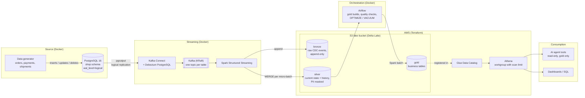

# cdc-lakehouse-aws

Real-time change data capture from PostgreSQL into a Delta Lake lakehouse on Amazon S3,
with a gold layer that dashboards and AI agents can query safely.

> **Status:** work in progress. See [Roadmap](#roadmap).

## Why this project

Most small companies want to "add AI" on top of data that lives in an operational
database, gets exported by nightly scripts, and nobody fully trusts. This project
shows an end-to-end alternative that a startup can run without a data team:

- Every insert, update and delete in the source database is captured within seconds.
- History is kept (order status transitions, price changes), not overwritten.
- PII never leaves the silver layer unmasked.
- The gold layer is cheap to query on AWS and exposed to an AI agent through
  narrow, read-only tools instead of raw database access.

The example domain is **ShopFlow**, a fictional LATAM e-commerce. See
[docs/data-model.md](docs/data-model.md).

## Architecture



### Data flow

1. **Capture.** Debezium reads the PostgreSQL write-ahead log through a logical
   replication slot and publishes one event per row change to Kafka
   (`shopflow.shop.<table>`). Each event carries the row before and after the change.
2. **Bronze.** A Spark streaming job appends every event as-is to Delta tables on S3,
   partitioned by table and date. Bronze is the replayable audit log.
3. **Silver.** A second streaming query `MERGE`s each micro-batch into clean tables:
   current state for most entities, SCD Type 2 history for `products`, an
   `order_status_history` table built from status transitions, and masked PII.
   Late or duplicated events are resolved using the source LSN, so reprocessing is
   idempotent.
4. **Gold.** Airflow rebuilds business tables from silver on a schedule (sales by
   country and category, payment failure rates, late shipments, order lead times,
   customer lifetime value) and runs data quality checks before publishing them.
5. **Serve.** Gold tables are registered in the Glue Data Catalog and queried with
   Athena. The AI agent gets a small set of read-only tools on top of those tables.

### Where each piece runs

| Component | Runs on | Why |
|---|---|---|
| PostgreSQL, Kafka, Debezium, Spark, Airflow | Docker Compose on a single VM, with per-service memory limits and profiles | Keeps the always-on cost at zero; the same images run on ECS/EKS |
| Delta tables (bronze, silver, gold) | Amazon S3 | Durable, cheap storage that any engine can read |
| Catalog and SQL | AWS Glue Data Catalog + Amazon Athena | Serverless, pay per query, no cluster to keep running |
| AI agent tools | Container on the VM, calling Athena | Narrow, read-only access to gold |
| AWS infrastructure | Terraform | Reproducible, reviewable, destroyable with one command |

## Design decisions

| Decision | Alternative considered | Reasoning |
|---|---|---|
| Debezium + Kafka for CDC | AWS DMS | Debezium is open source, keeps before/after images and ordering per key, and runs anywhere. DMS is a good fit when the team wants a managed service and is already all-in on AWS. |
| Self-managed Kafka in Docker | Amazon MSK | MSK starts at hundreds of USD per month. For production with real SLAs, MSK (or MSK Serverless) is what I would recommend. |
| Airflow in Docker | Amazon MWAA | Same reasoning: MWAA has a fixed monthly cost. The DAGs are portable to MWAA unchanged. |
| Delta Lake | Apache Iceberg | Delta has mature `MERGE` support in open-source Spark and Athena reads it natively. Iceberg would be the choice if the client is standardising on it. |
| Athena over gold only | Querying silver directly | Gold tables are small, documented and free of PII, which keeps both query cost and agent risk low. |
| Agent tools instead of free-form SQL | Letting the LLM write SQL | Predictable cost and behaviour; every tool maps to a question the business actually asks. |
| `REPLICA IDENTITY FULL` on source tables | Default (primary key only) | Full before-images make status transitions and price history trivial to derive, at the cost of more WAL. |

## Security

- No long-lived AWS keys for humans; the pipeline uses an IAM identity scoped to
  the lake bucket only, and the agent uses a read-only identity scoped to gold and
  Athena.
- S3 bucket: encryption at rest, public access blocked, TLS enforced.
- Secrets live in an untracked `.env`, never in the repository.
- PII (`email`, `full_name`) is hashed in silver; gold contains no PII.

## Cost

Target: **under USD 5 per month** on AWS for the demo (S3 storage, Athena scans,
Glue catalog), with an AWS Budget alarm in place. The compute runs on an existing VM.

## Quickstart

Requirements: Docker with Compose v2, about 3 GB of free RAM.

```bash
cp docker/.env.example docker/.env      # then fill in two random passwords
docker compose -f docker/compose.yaml up -d
./scripts/register-connector.sh         # registers the Debezium connector
```

Make a change in the source database and watch it arrive in Kafka:

```bash
docker compose -f docker/compose.yaml exec postgres \
  psql -U shopflow_admin -d shopflow -c "UPDATE shop.orders SET status = 'paid' WHERE order_id = 1"

docker compose -f docker/compose.yaml exec kafka /opt/kafka/bin/kafka-console-consumer.sh \
  --bootstrap-server localhost:9092 --topic shopflow.shop.orders --from-beginning
```

Start the live data generator (customers ordering, paying with failures and retries, shipping,
price changes, cart edits that produce deletes):

```bash
docker compose -f docker/compose.yaml --profile generator up -d generator
docker compose -f docker/compose.yaml logs -f generator     # progress every 60 s
```

Time is compressed (one simulated hour = 60 s by default). Tune it with `GENERATOR_RATE` (actions per
second, default 1) and `GENERATOR_TIME_SCALE` in `docker/.env`. The generator connects with its own
role that can only read and write rows in the `shop` schema.

Optional web UI for topics and connectors: `docker compose -f docker/compose.yaml --profile ui up -d`,
then open <http://localhost:8090>.

Each event carries the row `before` and `after` the change, the operation (`c`, `u`, `d`, or `r` for
snapshot reads) and the source LSN, which the silver layer uses to apply changes exactly once.

| Service | Image | Memory limit |
|---|---|---|
| PostgreSQL (source) | `postgres:16-bookworm` | 512 MB |
| Kafka (KRaft, single node) | `apache/kafka:4.3.1` | 1 GB |
| Kafka Connect + Debezium | `quay.io/debezium/connect:3.6.2.Final` | 1 GB |
| Data generator (optional) | built from `generator/` | 128 MB |
| kafka-ui (optional) | `kafbat/kafka-ui:v1.5.0` | 512 MB |

Debezium connects with a dedicated role that only has `REPLICATION` and read access to the
`shop` schema, and its password reaches the connector through Kafka's `EnvVarConfigProvider`,
so it never appears in the connector config or the REST API.

## AWS infrastructure (Terraform)

Two stacks under `terraform/`:

| Stack | Creates | State |
|---|---|---|
| `bootstrap/` | S3 bucket for Terraform state (versioned, encrypted, TLS-only, `prevent_destroy`) | Local (copied to the state bucket as a backup) |
| `lake/` | Lake bucket (`bronze/`, `silver/`, `gold/`, `_checkpoints/`), lifecycle rules, pipeline IAM identity | S3 backend with native lockfile (no DynamoDB) |

```bash
cd terraform/bootstrap && terraform init && terraform apply
cd ../lake
cp backend.hcl.example backend.hcl        # set the state bucket from the bootstrap output
terraform init -backend-config=backend.hcl && terraform apply
aws iam create-access-key --user-name cdc-lakehouse-pipeline   # store it outside git
```

Choices worth calling out:

- **No access keys in Terraform.** The pipeline user is managed in code, but its key is created with the
  CLI so the secret never lands in Terraform state.
- **Least privilege, verified.** The pipeline identity can read, write and delete only under the lake
  prefixes. Writing to the bucket root, reading Terraform state, listing other buckets, IAM calls and
  plain-HTTP requests are all denied.
- **SSE-S3 instead of a customer-managed KMS key**, which would add a fixed monthly cost per key.
- **No S3 versioning on the lake.** Delta Lake keeps its own table history; versioning would retain every
  file that `VACUUM` deletes.
- **Account id never hardcoded.** Bucket names are derived at plan time and the backend bucket comes from a
  git-ignored `backend.hcl`.

## Roadmap

- [x] Source data model and schema
- [x] Architecture
- [x] Local stack: PostgreSQL, Kafka, Debezium (Docker Compose)
- [x] Data generator with live changes
- [x] AWS infrastructure in Terraform: S3 lake, remote state, least-privilege pipeline identity
- [ ] Glue Data Catalog and Athena workgroup (Terraform)
- [ ] Bronze and silver streaming jobs (Spark + Delta on S3)
- [ ] Gold layer and data quality checks (Airflow)
- [ ] AI agent tools over gold
- [ ] Demo video

## Repository layout

```
docker/      Docker Compose stack and service configs
generator/   Live data generator for the source database
scripts/     Helper scripts
terraform/   AWS infrastructure
spark/       Streaming and batch jobs
airflow/     DAGs
agent/       AI agent tools over the gold layer
docs/        Data model and design notes
```

## License

[MIT](LICENSE)
