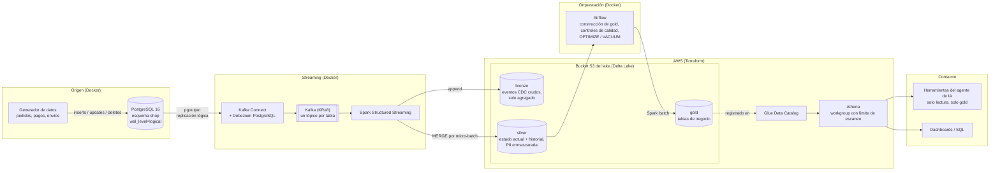

# cdc-lakehouse-aws

🌎 Español | [English](README.en.md)

Captura de cambios (CDC) en tiempo real desde PostgreSQL hacia un lakehouse con Delta Lake en Amazon S3,
con una capa gold que dashboards y agentes de IA pueden consultar de forma segura.

## Por qué este proyecto

Muchas empresas quieren "sumar IA" sobre datos que viven en la base operativa, se exportan con scripts
nocturnos y en los que nadie confía del todo. Este proyecto muestra una alternativa de punta a punta que
una startup puede operar sin un equipo de datos:

- Cada insert, update y delete del origen se captura en segundos, y se conserva el historial.
- Los datos personales nunca llegan sin enmascarar a las capas que se consultan.
- Nada se publica sin pasar controles de calidad.
- Un agente de IA responde preguntas de negocio con herramientas de solo lectura, nunca con SQL libre.

El ejemplo es **ShopFlow**, un e-commerce ficticio de LATAM ([modelo de datos](docs/data-model.md)).

## Arquitectura



**Bronze** guarda cada evento tal como llega (log reprocesable), **silver** mantiene el estado actual y el
historial con `MERGE` idempotente, y **gold** tiene tablas de negocio chicas que Airflow reconstruye y
audita antes de publicar. Athena consulta gold y el agente accede solo a través de herramientas fijas.

## Resultados verificados

- **Exactly-once de Kafka a bronze:** 0 duplicados y 0 huecos en los offsets de los 6 tópicos.
- **Silver idéntico al origen:** después de ~200,000 eventos de cambio, 15 métricas de negocio (cantidades y
  montos por estado de pedidos, pagos, envíos, clientes y precios) coinciden exactamente con PostgreSQL.
- **Reprocesamiento sin efectos:** con el checkpoint borrado y toda la historia reprocesada, los `MERGE`
  reportaron 0 filas insertadas, actualizadas o eliminadas.
- **El audit dice que no:** 25 controles de calidad (write-audit-publish) bloquearon dos publicaciones en la
  primera corrida, ambas por problemas reales de datos.
- **Mínimo privilegio comprobado:** el pipeline solo escribe en los prefijos del lake y desde la IP de la VM;
  el agente solo puede ejecutar consultas de Athena, así que con su clave no se puede descargar ningún archivo.

## Stack

| Capa | Tecnología |
|---|---|
| Origen y CDC | PostgreSQL 16, Debezium 3.6 (`pgoutput`), Kafka 4.3 (KRaft) |
| Procesamiento | Spark 4.2 Structured Streaming, Delta Lake 4.4 |
| Almacenamiento y consulta | Amazon S3, AWS Glue Data Catalog, Amazon Athena |
| Orquestación | Airflow 3.3 (`gold_pipeline` cada 15 min, mantenimiento diario) |
| Agente de IA | Servidor MCP con 8 herramientas de solo lectura ([diseño](docs/agent-tools.md)) |
| Infraestructura | Terraform, Docker Compose con límites de memoria |

**Costo:** pocos dólares al mes en AWS (almacenamiento en S3 y consultas de Athena con límite de 1 GB),
con una alarma de AWS Budget. El cómputo corre en una VM existente.

## Inicio rápido

Requisitos: Docker con Compose v2 y unos 3 GB de RAM libre.

```bash
cp docker/.env.example docker/.env               # completa las contraseñas
docker compose -f docker/compose.yaml up -d      # PostgreSQL, Kafka y Debezium
./scripts/register-connector.sh                  # registra el conector de CDC
docker compose -f docker/compose.yaml --profile generator up -d generator   # datos en vivo
```

La puesta en marcha completa (Spark, Terraform, Airflow y el agente) está en el
[detalle técnico](docs/detalle-tecnico.md#inicio-rápido).

## Documentación

- [Detalle técnico](docs/detalle-tecnico.md): flujo de datos, decisiones de diseño (y cuándo elegiría la
  alternativa administrada de AWS), seguridad y cada capa en profundidad.
- [Modelo de datos](docs/data-model.md): dominio, tablas de origen y decisiones de CDC.
- [Herramientas del agente](docs/agent-tools.md): diseño, guardrails y limitaciones de los datos.

## Próximos pasos

- [ ] Generador: transportistas coherentes con el país del cliente
- [ ] Gold: shipments_daily (denominador de entregas a tiempo para las tasas de demora) y metadatos de construcción para la frescura
- [ ] Video de demostración

## Estructura del repositorio

```
docker/      Stack de Docker Compose y configuración de los servicios
generator/   Generador de datos en vivo para la base de origen
scripts/     Scripts auxiliares
terraform/   Infraestructura de AWS
spark/       Jobs de streaming y batch
airflow/     DAGs
agent/       Servidor MCP con herramientas de solo lectura para el agente de IA
docs/        Detalle técnico, modelo de datos y diseño del agente (en inglés en docs/en/)
```

## Licencia

[MIT](LICENSE)
