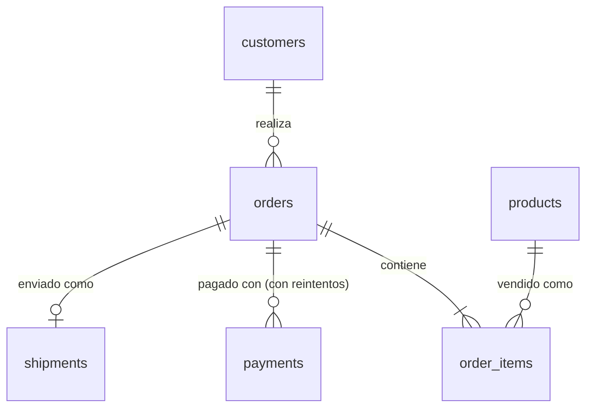

# Modelo de datos

## Dominio: ShopFlow

ShopFlow es una empresa ficticia de e-commerce que vende en LATAM. Su base de datos
operativa (PostgreSQL) es la fuente de verdad; el lakehouse nunca escribe en ella.

Se eligió este dominio porque genera el tipo de cambios que justifican usar CDC, y que
una extracción batch perdería o aplanaría:

| Comportamiento en el origen | Por qué importa aguas abajo |
|---|---|
| Los pedidos pasan por `pending → paid → shipped → delivered` (o `cancelled`) | Los tiempos del embudo y el historial de estados solo existen si se captura cada transición |
| Los pagos fallan y se reintentan como filas nuevas | Tasa de fallos por proveedor y motivo; los ingresos deben contar solo los pagos capturados |
| Los precios de los productos cambian | Los ingresos deben usar el precio al momento de la compra; silver conserva el historial de precios (SCD2) |
| Los envíos tienen una fecha prometida | Las entregas tardías son una alerta operativa que el agente de IA puede mostrar |
| Los clientes contienen PII (email, nombre) | Se enmascara en silver; gold y el agente nunca ven PII sin procesar |

## Tablas de origen (esquema `shop`)

| Tabla | Granularidad | Columnas mutables principales |
|---|---|---|
| `customers` | una fila por cliente | `email`, `full_name`, `country` |
| `products` | una fila por SKU | `unit_price`, `is_active` |
| `orders` | una fila por pedido | `status`, `total_amount` |
| `order_items` | una fila por línea de pedido | (en la práctica, solo inserciones) |
| `payments` | una fila por intento de pago | `status`, `failure_code` |
| `shipments` | una fila por pedido enviado | `status`, `shipped_at`, `delivered_at` |

DDL: [`docker/postgres/init/01_schema.sql`](../docker/postgres/init/01_schema.sql).

### Decisiones específicas de CDC

- **`REPLICA IDENTITY FULL`** en todas las tablas, para que los eventos de update y delete
  incluyan la fila anterior completa. Implica algo más de volumen de WAL; es aceptable a
  esta escala y queda documentado como trade-off para producción.
- **`updated_at` mantenido por trigger**, no por la aplicación, para que cada cambio
  tenga un timestamp confiable aunque un cliente olvide asignarlo.
- **Una sola publicación (`shopflow_cdc`) para todo el esquema**, consumida por Debezium
  con el plugin nativo `pgoutput` (sin extensiones que instalar en el origen).

## Preguntas objetivo (lo que gold debe responder)

Estas preguntas guían la capa gold y las herramientas del agente de IA:

1. ¿Cuánto vendimos hoy / esta semana, por país y categoría?
2. ¿Qué proporción de los pagos falla, por proveedor y motivo de fallo?
3. ¿Qué pedidos están atrasados respecto de su fecha de entrega prometida en este momento?
4. ¿Cuánto tarda un pedido desde `pending` hasta `delivered`?
5. ¿Quiénes son los mejores clientes por valor de vida (lifetime value) sin exponer PII?
