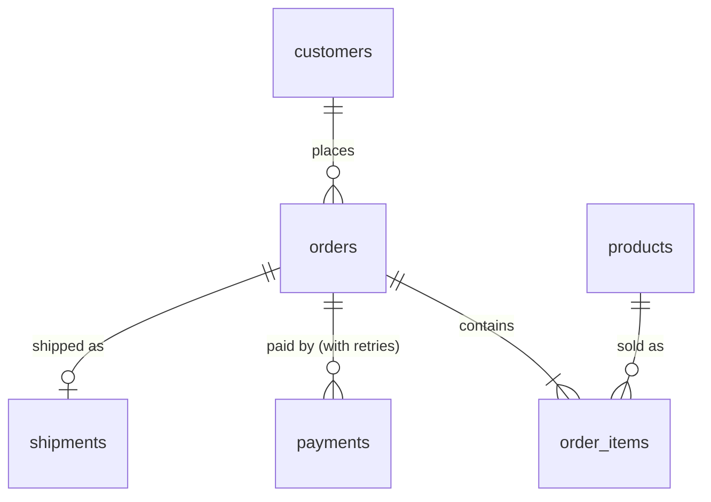

# Data model

## Domain: ShopFlow

ShopFlow is a fictional e-commerce company selling across LATAM. Its operational
database (PostgreSQL) is the source of truth; the lakehouse never writes back to it.

The domain was chosen because it produces the kinds of changes that make CDC worth
it, and that a batch extract would miss or flatten:

| Behaviour in the source | Why it matters downstream |
|---|---|
| Orders move through `pending → paid → shipped → delivered` (or `cancelled`) | Funnel timing and status history only exist if every transition is captured |
| Payments fail and are retried as new rows | Failure rate by provider and reason; revenue must count only captured payments |
| Product prices change | Revenue must use the price at purchase time; silver keeps price history (SCD2) |
| Shipments have a promised date | Late deliveries are an operational alert the AI agent can surface |
| Customers hold PII (email, name) | Masked in silver; gold and the agent never see raw PII |

## Source tables (`shop` schema)

| Table | Grain | Key mutable columns |
|---|---|---|
| `customers` | one row per customer | `email`, `full_name`, `country` |
| `products` | one row per SKU | `unit_price`, `is_active` |
| `orders` | one row per order | `status`, `total_amount` |
| `order_items` | one row per order line | (insert-only in practice) |
| `payments` | one row per payment attempt | `status`, `failure_code` |
| `shipments` | one row per order shipped | `status`, `shipped_at`, `delivered_at` |

DDL: [`docker/postgres/init/01_schema.sql`](../../docker/postgres/init/01_schema.sql).

### CDC-specific choices

- **`REPLICA IDENTITY FULL`** on every table, so update and delete events carry the
  full previous row. Costs some WAL volume; acceptable at this scale and documented
  as a trade-off for production.
- **`updated_at` maintained by trigger**, not by the application, so every change
  has a trustworthy timestamp even when a client forgets to set it.
- **One publication (`shopflow_cdc`) for the whole schema**, consumed by Debezium
  with the native `pgoutput` plugin (no extensions to install on the source).

## Target questions (what gold must answer)

These drive the gold layer and the AI agent's tools:

1. How much did we sell today / this week, by country and category?
2. What share of payments fail, by provider and failure reason?
3. Which orders are late against their promised delivery date right now?
4. How long does an order take from `pending` to `delivered`?
5. Who are the top customers by lifetime value (without exposing PII)?
